 

 

Hi, I'm **Spey** (speyvenerable). I design and build personal software projects, mostly on Android with Acode and Termux. I like clean interfaces, a cyberpunk look and making things that work offline.

<table>
<tr>
<td align="center" width="50%">
<a href="https://speyvenerable.github.io/Epubreader/"><b>EPUBREADER</b></a> 
Installable book reader. Upload EPUB, PDF or TXT, read offline, jump by chapter.  
<a href="https://github.com/Speyvenerable/Epubreader">Code</a> · <a href="https://speyvenerable.github.io/Epubreader/">Open</a>
</td>
<td align="center" width="50%">
<a href="https://speyvenerable.github.io/Portfolio/"><b>PROFILE PORTFOLIO</b></a> 
Cyberpunk one-scroll portfolio with a glitch gallery and music.  
<a href="https://github.com/Speyvenerable/Portfolio">Code</a> · <a href="https://speyvenerable.github.io/Portfolio/">Open</a>
</td>
</tr>
</table>

- **Discord:** `speyvenerable`
- **Gmail:** [Bathlukspey@gmail.com](mailto:Bathlukspey@gmail.com)
- **Portfolio:** [speyvenerable.github.io/Portfolio](https://speyvenerable.github.io/Portfolio/)

